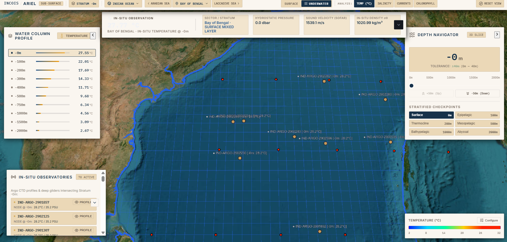
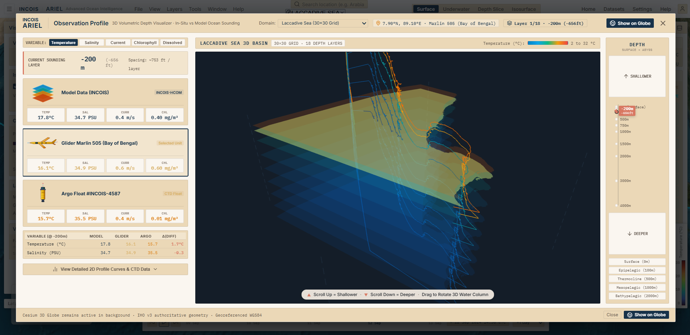

Here's an updated **README.md** with a proper **Screenshots** section that references the images you shared.  

**Recommendation:** Create a folder `docs/screenshots/` (or `assets/`) in the repo and save the images with clean names. The references below assume that structure.

```markdown
# Oceiana (ARIEL)

**Web-Based Interactive 3D Ocean Visualization Platform**

Built for **Smart India Hackathon (SIH 2026)** — Problem Statement **SIH26067**  
Sponsoring Ministry: Ministry of Earth Sciences (MoES)  
Department: Indian National Centre for Ocean Information Services (INCOIS) — Ocean Valley  
Theme: Disaster Management  

Also developed for **AIU Anveshan 2026-27**.

> An honest, real-data ocean intelligence platform that turns marine observations into an interactive 4D view of the ocean — helping researchers explore temperature, salinity, currents, biological conditions, and changing marine environments.

**Live demo:** [bablu-blast.vercel.app](https://bablu-blast.vercel.app)

---

## Screenshots

### Landing Experience


*Hero section introducing ARIEL as an ocean intelligence platform built on real marine observations.*

---

### Science Overview


*High-level view of the three core scientific pillars: Ocean Temperature, Ocean Salinity, and Ocean Dynamics.*

---

### Interactive 3D Globe


*Main visualization workspace showing real Argo float positions and glider trajectories over the Indian Ocean / Bay of Bengal. Left panel provides visualization controls (variable, isosurface, colorbar, opacity, vertical exaggeration). Right panel lists active instruments and model data layers.*

---

### Observation Profile — Model vs In-Situ Comparison



*Detailed 3D volumetric depth visualizer comparing Model (INCOIS), Glider, and Argo soundings at the same location and depth. Includes side-by-side values, difference calculation, and interactive water-column rotation.*

---

### Underwater / Depth Navigation View



*Underwater mode with water-column temperature profile, depth navigator, stratified checkpoints (Surface → Abyssal), and live in-situ observatories intersecting the current stratum.*

---

## Problem Statement

INCOIS generates large volumes of 3D ocean model output (temperature, salinity, currents, chlorophyll) and collects real-time/delayed-mode observations from Argo floats and Gliders — stored as NetCDF/ASCII across multiple depths, grids, and time steps.

No existing tool lets forecasters co-visualize model fields and in-situ instrument data in one interactive, web-based, 3D environment. Current tools are desktop-bound, 2D-only, or cannot overlay instruments on model fields.

---

## Solution Overview

Oceiana (branded as **ARIEL** in the UI) is a browser-native 3D Ocean Data Visualization System that delivers:

- 3D volumetric rendering of temperature, salinity, and currents
- Depth-slice views and isosurface extraction
- Time-step animation of ocean fields
- Instrument data overlay (Argo floats, Gliders, CTD/BGC) with click-to-profile charts
- Modular multi-format data ingestion (NetCDF + delimited text)
- Customizable colorbars, variable selectors, opacity, and vertical exaggeration
- OPeNDAP-style REST API for sliced queries
- Extensible plugin architecture for future sensors

**Primary focus region:** Bay of Bengal (5–23°N, 80–100°E)

---

## Architecture

```
MODEL DATA (LAS / Copernicus)      ARGO / GLIDER / CTD-BGC (Ifremer)
           │                                    │
           ▼                                    ▼
  ┌──────────────────┐              ┌──────────────────────┐
  │ NetCDF Parser    │              │ Modular Instrument   │
  │ Module (xarray)  │              │ Parser Modules       │
  └────────┬─────────┘              └──────────┬───────────┘
           │                                   │
           └───────────────┬───────────────────┘
                           ▼
              ┌─────────────────────────┐
              │ Shared Internal Schema  │
              └───────────┬─────────────┘
                          ▼
              ┌─────────────────────────┐
              │ FastAPI — OPeNDAP-style │
              │ sliced query endpoints  │
              └───────────┬─────────────┘
                          ▼
              ┌─────────────────────────┐
              │ React + Cesium Frontend │
              │ 3D Globe + Profile Views │
              └─────────────────────────┘
```

### Tech Stack

| Layer      | Technology                                      |
|------------|--------------------------------------------------|
| Frontend   | React 19 + TypeScript + Vite + CesiumJS         |
| Backend    | FastAPI (Python 3.13) + Uvicorn                 |
| Scientific | xarray, netCDF4, gsw (TEOS-10), scipy, pandas, argopy, erddapy |
| Data       | Real Argo NetCDF + IFREMER glider caches        |

---

## Project Structure

```
Oceiana/
├── backend/                 # FastAPI scientific backend
│   ├── app/
│   ├── data/
│   ├── storage/
│   ├── tests/
│   └── main.py
├── frontend/                # React + CesiumJS 3D visualization
│   ├── src/
│   └── public/
├── data/raw/                # Shared raw NetCDF files
├── docs/
│   └── screenshots/         # UI screenshots used in this README
├── .env.example
├── requirements.txt
├── start_offline.sh
├── start_offline.bat
├── BACKEND_ARCHITECTURE.md
├── BACKEND_API_CONTRACT.md
├── CONTEXT.md
└── description.md
```

---

## Getting Started

### Prerequisites

- Python 3.11+ (tested on 3.13)
- Node.js 18+
- Cesium Ion access token ([cesium.com/ion](https://cesium.com/ion))

### 1. Clone

```bash
git clone https://github.com/flickstrokefs/Oceiana.git
cd Oceiana
```

### 2. Backend

```bash
cd backend
python -m venv .venv
source .venv/bin/activate          # Windows: .venv\Scripts\activate
pip install -r requirements.txt

cp ../.env.example .env
# Add your VITE_CESIUM_ION_TOKEN and optional CMEMS credentials
```

Run:

```bash
uvicorn app.main:app --reload --host 0.0.0.0 --port 8000
```

- Swagger UI: http://localhost:8000/api/docs

### 3. Frontend

```bash
cd frontend
npm install
npm run dev
```

### 4. One-click Offline Demo

```bash
# Linux / Mac / WSL
./start_offline.sh

# Windows
start_offline.bat
```

---

## Real Data Currently Included

| Dataset                          | Source                  | Status          |
|----------------------------------|-------------------------|-----------------|
| Argo Bay of Bengal (Jan 2020)    | Ifremer ERDDAP          | **REAL** (9,124 rows / 51 profiles) |
| IFREMER Glider missions          | OceanGliders GDAC       | **REAL** (~30 missions) |
| Ocean field meshes               | Placeholder formulas    | **SYNTHETIC**   |
| Hazard / PFZ panels              | Placeholder             | **SYNTHETIC**   |

All data carries explicit provenance: `REAL` | `DERIVED` | `SIMULATED` | `SYNTHETIC`.

---

## Key Features

- Interactive Cesium 3D globe with real Argo + glider positions
- Click any instrument → full depth-vs-variable profile
- Side-by-side Model vs Glider vs Argo comparison
- TEOS-10 thermodynamic calculations
- Vertical gradient computation
- Modular dataset upload pipeline
- Marine hazard exceedance analysis
- Potential Fishing Zone (PFZ) advisories
- Strict scientific provenance tracking

---

## Development Roadmap

| Phase | Status     | Description                                      |
|-------|------------|--------------------------------------------------|
| 0     | Done       | Audit — real vs synthetic inventory              |
| 1     | Done       | Remove falsehoods & fix provenance               |
| 2     | In progress| Real data fetcher layer (Argo, CMEMS, SST/Chl)   |
| 3     | Planned    | Scientific products (MLD, D26, TCHP, fronts…)    |
| 4     | Planned    | Visual reports (thermal / cyclone heat / fishing)|
| 5     | Planned    | Full globe/map layer integration                 |
| 6     | Planned    | Offline packaging for competition demos          |

---

## Non-Negotiable Rules

1. No fabricated numbers in the UI.
2. Provenance on everything: `REAL` | `DERIVED` | `SIMULATED` | `SYNTHETIC`.
3. No unsourced claims.
4. This is not a forecast system — we present operational forecasts.
5. Offline must work (every fetcher caches to disk).

---

## Acknowledgements

- Ministry of Earth Sciences (MoES) & INCOIS  
- Ifremer / Coriolis GDAC (Argo data)  
- IFREMER OceanGliders  
- Copernicus Marine Service (planned)  
- CesiumJS community  

---

**Oceiana / ARIEL** — Making ocean data accessible, interactive, and scientifically honest.
```

### How to use the screenshots

1. Create the folder:
   ```bash
   mkdir -p docs/screenshots
   ```

2. Save your images with these exact names (or update the paths in the README):

   | Your image | Suggested filename |
   |------------|--------------------|
   | Landing page (Earth hero) | `01-landing.png` |
   | Science cards section | `02-science-cards.png` |
   | Main 3D globe | `03-3d-globe.png` |
   | Observation Profile modal | `04-observation-profile.png` |
   | Underwater depth view | `05-underwater-view.png` |

3. Commit them together with the README.

