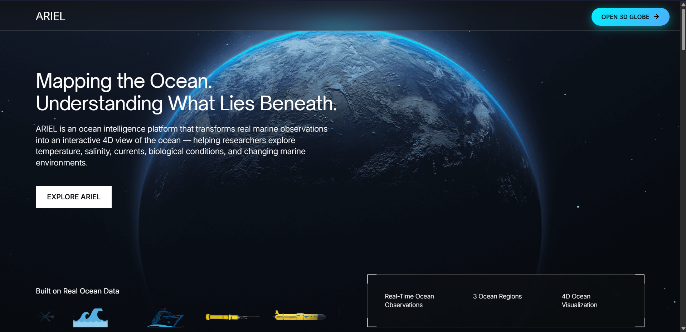
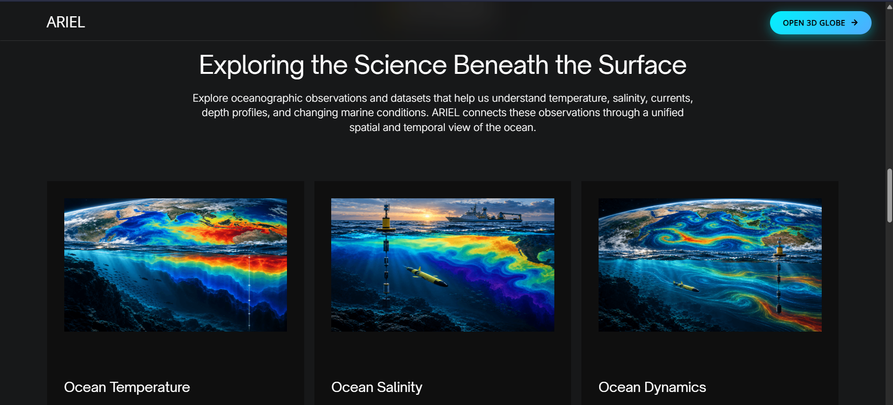
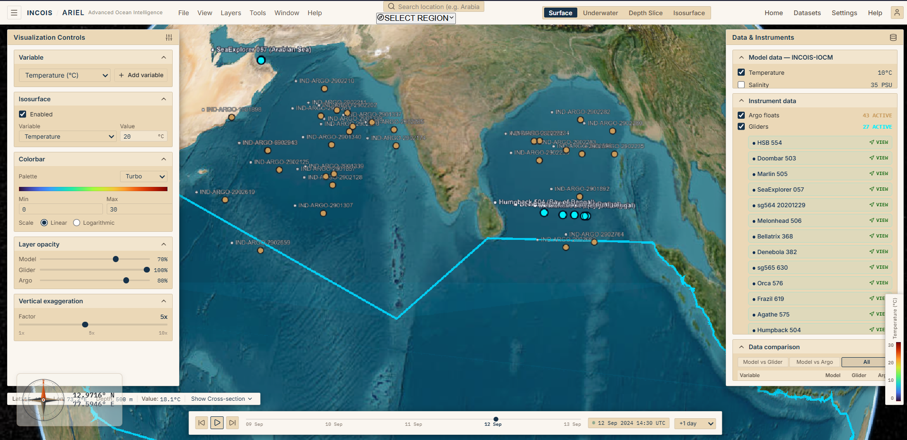

# Oceiana (ARIEL)

**Web-Based Interactive 3D Ocean Visualization Platform**

Built for **Smart India Hackathon (SIH) 2026** --- Problem Statement
**SIH26067**\
Sponsoring Ministry: Ministry of Earth Sciences (MoES)\
Department: Indian National Centre for Ocean Information Services
(INCOIS)\
Theme: Disaster Management

Also developed for **AIU Anveshan 2026--27**.

> An ocean intelligence platform that turns marine observations into an
> interactive, time-aware view of the ocean, helping researchers explore
> temperature, salinity, currents, biological conditions, and changing
> marine environments.

**Live demo:** [bablu-blast.vercel.app](https://bablu-blast.vercel.app)

------------------------------------------------------------------------

## Screenshots

Place the screenshots in `docs/screenshots/` using the filenames shown
below.

### Landing Experience



*Hero section introducing ARIEL as an ocean intelligence platform built
around marine observations.*

### Science Overview



*Overview of three core scientific pillars: ocean temperature, ocean
salinity, and ocean dynamics.*

### Interactive 3D Globe



*Main visualization workspace showing Argo float positions and glider
trajectories over the Indian Ocean and Bay of Bengal. The left panel
provides visualization controls, while the right panel lists active
instruments and data layers.*

### Observation Profile: Model vs. In-Situ Comparison


*Depth-profile view for comparing model output (INCOIS) with glider and
Argo observations at a selected location. Includes side-by-side values,
difference calculations, and an interactive water-column view.*

### Underwater / Depth Navigation


*Underwater mode with a water-column temperature profile, depth
navigator, stratified checkpoints from surface to abyssal depths, and
in-situ observatories intersecting the selected depth range.*

------------------------------------------------------------------------

## Problem Statement

INCOIS generates large volumes of 3D ocean-model output, including
temperature, salinity, currents, and chlorophyll. It also collects
real-time and delayed-mode observations from Argo floats and underwater
gliders. These datasets are distributed in formats such as NetCDF and
ASCII, across multiple depths, grids, and time steps.

Researchers need a way to explore model fields and in-situ instrument
observations together. Existing workflows can be desktop-bound,
primarily 2D, or lack a unified way to overlay instrument observations
on model fields in an interactive environment.

## Solution Overview

Oceiana, branded as **ARIEL** in the user interface, is a browser-based
3D ocean data visualization platform designed to bring model data and
in-situ observations into one workspace.

It provides:

-   3D visualization of ocean temperature, salinity, and currents
-   Depth-slice views and isosurface extraction
-   Time-step animation of ocean fields
-   Instrument overlays for Argo floats, gliders, and supported CTD/BGC
    observations
-   Click-to-explore instrument profiles
-   Modular data ingestion for NetCDF and delimited text
-   Configurable color maps, variable selectors, opacity, and vertical
    exaggeration
-   OPeNDAP-style REST endpoints for sliced data queries
-   An extensible architecture for additional instruments and data
    sources

**Primary focus region:** Bay of Bengal (5--23°N, 80--100°E)

------------------------------------------------------------------------

## Architecture

``` text
MODEL DATA (LAS / Copernicus)       ARGO / GLIDER / CTD-BGC
             │                                  │
             ▼                                  ▼
    ┌──────────────────┐              ┌──────────────────────┐
    │ NetCDF Parser    │              │ Modular Instrument   │
    │ Module (xarray)  │              │ Parser Modules       │
    └────────┬─────────┘              └──────────┬───────────┘
             │                                  │
             └────────────────┬─────────────────┘
                              ▼
                 ┌─────────────────────────┐
                 │ Shared Internal Schema  │
                 └───────────┬─────────────┘
                             ▼
                 ┌─────────────────────────┐
                 │ FastAPI — OPeNDAP-style │
                 │ sliced-query endpoints  │
                 └───────────┬─────────────┘
                             ▼
                 ┌─────────────────────────┐
                 │ React + Cesium Frontend │
                 │ 3D Globe + Profile Views│
                 └─────────────────────────┘
```

### Tech Stack

  -----------------------------------------------------------------------
  Layer                               Technology
  ----------------------------------- -----------------------------------
  Frontend                            React 19, TypeScript, Vite,
                                      CesiumJS

  Backend                             FastAPI, Python 3.13, Uvicorn

  Scientific computing                xarray, netCDF4, gsw (TEOS-10),
                                      SciPy, pandas, argopy, erddapy

  Data                                Argo NetCDF files and IFREMER
                                      glider caches
  -----------------------------------------------------------------------

### Project Structure

``` text
Oceiana/
├── backend/                 # FastAPI scientific backend
│   ├── app/
│   ├── data/
│   ├── storage/
│   ├── tests/
│   └── main.py
├── frontend/                # React + CesiumJS visualization
│   ├── src/
│   └── public/
├── data/
│   └── raw/                  # Shared raw NetCDF files
├── docs/
│   └── screenshots/         # README screenshots
├── .env.example
├── requirements.txt
├── start_offline.sh
├── start_offline.bat
├── BACKEND_ARCHITECTURE.md
├── BACKEND_API_CONTRACT.md
├── CONTEXT.md
└── description.md
```

------------------------------------------------------------------------

## Getting Started

### Prerequisites

-   Python 3.11 or later (tested with Python 3.13)
-   Node.js 18 or later
-   A Cesium ion access token: [cesium.com/ion](https://cesium.com/ion)

### 1. Clone the repository

``` bash
git clone https://github.com/flickstrokefs/Oceiana.git
cd Oceiana
```

### 2. Set up the backend

From the repository root:

``` bash
cd backend
python -m venv .venv
```

Activate the virtual environment:

``` bash
# Linux / macOS
source .venv/bin/activate

# Windows PowerShell
.venv\Scripts\Activate.ps1

# Windows Command Prompt
.venv\Scripts\activate.bat
```

Install dependencies and configure environment variables:

``` bash
pip install -r requirements.txt
```

Create the environment file from the example:

``` bash
# Linux / macOS
cp ../.env.example ../.env

# Windows Command Prompt
copy ..\.env.example ..\.env
```

Add the required Cesium ion token and any optional data-provider
credentials to the appropriate environment files. Keep secrets out of
version control. If the frontend reads a `VITE_` variable, define it in
the frontend's environment file because Vite exposes frontend variables
at build/dev time.

Run the backend from the `backend/` directory:

``` bash
uvicorn app.main:app --reload --host 0.0.0.0 --port 8000
```

-   API documentation: <http://localhost:8000/api/docs>

### 3. Set up the frontend

Open a second terminal:

``` bash
cd Oceiana/frontend
npm install
npm run dev
```

Use the local URL printed by Vite to open the application.

### 4. Run the offline demo

From the repository root:

``` bash
# Linux / macOS / WSL
./start_offline.sh

# Windows
start_offline.bat
```

------------------------------------------------------------------------

## Real Data Currently Included

  -----------------------------------------------------------------------
  Dataset                 Source                  Status
  ----------------------- ----------------------- -----------------------
  Argo Bay of Bengal      Ifremer ERDDAP          **REAL** --- 9,124 rows
  (January 2020)                                  / 51 profiles

  IFREMER glider missions OceanGliders GDAC       **REAL** ---
                                                  approximately 30
                                                  missions

  Ocean-field meshes      Placeholder formulas    **SYNTHETIC**

  Hazard / PFZ panels     Placeholder data        **SYNTHETIC**
  -----------------------------------------------------------------------

Data products carry provenance labels: `REAL`, `DERIVED`, `SIMULATED`,
or `SYNTHETIC`.

> Dataset counts and status labels should be kept in sync with the
> actual files and pipeline output in the repository.

## Key Features

-   Interactive CesiumJS 3D globe with Argo and glider positions
-   Instrument selection with depth-versus-variable profiles
-   Model-versus-observation comparisons
-   TEOS-10 seawater thermodynamic calculations
-   Vertical-gradient computation
-   Modular dataset upload and ingestion pipeline
-   Marine-hazard exceedance analysis
-   Potential Fishing Zone (PFZ) advisory panels
-   Scientific data provenance tracking

------------------------------------------------------------------------

## Development Roadmap

  -----------------------------------------------------------------------
  Phase                   Status                  Description
  ----------------------- ----------------------- -----------------------
  0                       Done                    Audit real versus
                                                  synthetic data
                                                  inventory

  1                       Done                    Remove unsupported
                                                  claims and correct
                                                  provenance

  2                       In progress             Real-data fetchers for
                                                  Argo, CMEMS, SST, and
                                                  chlorophyll

  3                       Planned                 Scientific products:
                                                  MLD, D26, TCHP, fronts,
                                                  and more

  4                       Planned                 Visual reports for
                                                  thermal conditions,
                                                  cyclone heat, and
                                                  fishing

  5                       Planned                 Full globe and
                                                  map-layer integration

  6                       Planned                 Offline packaging for
                                                  competition
                                                  demonstrations
  -----------------------------------------------------------------------

## Non-Negotiable Rules

1.  Do not display fabricated numbers as real observations.
2.  Every data product must carry provenance: `REAL`, `DERIVED`,
    `SIMULATED`, or `SYNTHETIC`.
3.  Do not make unsourced scientific claims.
4.  ARIEL is not presented as an independent forecasting system;
    forecast products must retain their source and operational context.
5.  Offline mode must use locally cached data where required.

------------------------------------------------------------------------

## Acknowledgements

-   Ministry of Earth Sciences (MoES) and INCOIS
-   Ifremer / Coriolis GDAC for Argo data
-   IFREMER OceanGliders
-   Copernicus Marine Service
-   CesiumJS community

------------------------------------------------------------------------

**Oceiana / ARIEL** --- Making ocean data accessible, interactive, and
scientifically honest.
